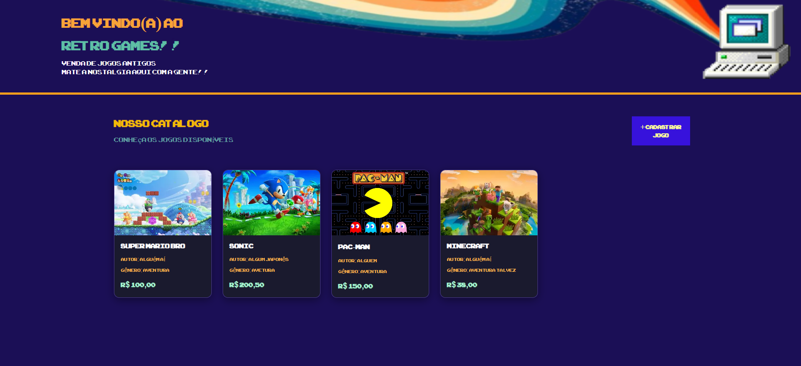

# Atividade Loja Retrô Games 

## Tacnologias usadas:

- HTML
- CSS
- JavaScript
- Vs Code

## Objetivo:
 Fazer uma loja com vibe jogos retrôs usando css, html e javascript.

 ## Atividades:
 - [server.js](./server.js)
 - [style.css](./style.css)
 - [script.js](./script.js)
 - [index.html](./index.html)

## Prints: 

